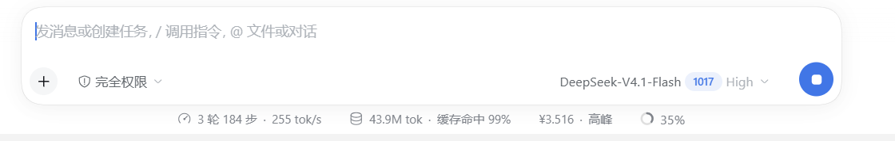

# dsh-billing-meter

DSH（DeepSeek Harness）Web 插件：**在输入框下方显示当前会话的人民币计费**，并按
DeepSeek 官方的**峰谷（高峰/空闲）时段**自动切换单价。点开读数能看到分桶明细、
当前时段、距下次切换的倒计时，以及规则与价格出处。

```
┌──────────────────────────────────────────────────────────┐
│  发消息或创建任务，/ 调用指令，@ 文件或对话               │
│  +   完全权限 ▾            DeepSeek-V4.1-Flash 1017 High ⇧│
└──────────────────────────────────────────────────────────┘
   ↻ 3 轮 184 步 · 255 tok/s   🗄 43.9M tok · 缓存命中 99%
   ¥3.516 · 高峰              ◔ 35%
   ^^^^^^^^^^^^^^ 本插件新增的计费读数
```

> 字号/行高/颜色/字重对齐同排官方统计 pill 的实测计算值（12px / 20px / 400 /
> `--dsw-alias-label-tertiary`），`¥` 与金额连写，不再另起视觉层级。



读数由官方 `conversation.composer.dock` 槽位渲染，与「轮次/步数」「token/缓存命中」
以及各连接器插件的积分读数同一行；不占新行、不顶掉别人的格子。点击后弹出明细：

```
会话计费（人民币）                              ¥1.535
──────────────────────────────────────────────────────
当前时段      高峰 09:00–12:00
距切换        1:42:28 后转空闲
计费模型      DeepSeek-V4.1-Flash · deepseek-account
缓存命中输入  12,239,360 tok × ¥0.04/M = ¥0.4896
未命中输入    157,451 tok × ¥2/M = ¥0.3149
输出          91,300 tok × ¥8/M = ¥0.7304
合计（当前时段价）                          ¥1.535
──────────────────────────────────────────────────────
规则：北京时间周一至周五 09:00–12:00、14:00–18:00 为
高峰（中国法定节假日除外），其余时段为空闲；空闲价为
高峰价的 50%。
价格来源：2026-10-19 核对 · DeepSeek 官方价格页
```

> 上例金额来自实测会话（点开明细时的 token 用量），仅用于说明展示效果。

## 峰谷规则（2026-10 现行）

| 时段 | 北京时间 | 单价 |
| --- | --- | --- |
| 高峰 | 周一至周五 09:00–12:00、14:00–18:00（不含中国法定节假日） | 标准价 |
| 空闲 | 其余全部时间，含周末与法定节假日全天 | 高峰价的 50% |

- 2025 年那套「00:30–08:30 错峰折扣」已于 **2025-09-06 凌晨调价时取消**，
  `deepseek-chat` / `deepseek-reasoner` 也已下线，本插件都不使用。现行峰谷机制
  自 2026-08-17 生效，周末全天空闲是 2026-08-23 的进一步调整。
- 高峰窗口按半开区间处理：09:00:00 起算高峰、12:00:00 起算空闲（官方只写到分钟，
  秒级边界属于本插件的文档化约定）。
- 内置 **2026 年落在工作日的 19 个法定节假日**；日历未覆盖的年份，读数仍按
  「工作日 09–12 / 14–18」估算，并在面板里标注「按工作日估算」。

## 价目表（元 / 百万 tokens，高峰价）

| 模型 | 缓存命中输入 | 缓存未命中输入 | 输出 |
| --- | --- | --- | --- |
| `deepseek-flash`（DeepSeek-V4.1-Flash） | 0.04 | 2 | 8 |
| `deepseek-v4-pro`（DeepSeek-V4-Pro） | 0.30 | 9.0 | 27.0 |

空闲价 = 上表 × 0.5（0.02 / 1 / 4 与 0.15 / 4.5 / 13.5）。费用公式：

```
费用 = 缓存命中 token × 命中价 + (未命中 token + 缓存写入 token) × 未命中价
     + 输出 token × 输出价        （单价均为 元/百万 tokens）
```

> **DeepSeek-V4-Pro 口径风险**：价格页仍列 0.30 / 9.0 / 27.0，但 2026-09-10 的更新
> 日志称 v4-pro 请求将路由到 V4.1-Flash 并按 Flash 单价计费，两处官方口径互相矛盾。
> 本插件以价格页为准，并在面板里标注「口径待确认」。

## 覆盖的模型与计价口径

- **模型映射**：`deepseek-flash` / `deepseek-v4-pro` 直接命中；各家 provider 的展示名
  按关键字归一——`DeepSeek-V4.1-Flash`、`DeepSeek-V4-Flash-Official`、
  `deepseek-v4.1-flash`、`DeepSeek-Flash` 都按 Flash 价，带 `pro` 的按 Pro 价。
- **非 DeepSeek 模型**（GLM / Kimi / Qwen…）没有官方人民币价，读数自动隐藏。
- **非官方直连 provider**（Trae / WorkBuddy / Qoder 等用积分计费的连接器）：金额按
  DeepSeek 官方价目表**参考估算**，面板里会明确标注「非官方直连」提示。
- **整会话按当前时段价估算**：`tokenUsage` 投影只给累计 token、不含每笔请求的时刻，
  因此跨峰谷的长会话在切换时段后金额会整体翻倍/减半。精确账单以官方为准。
- **缓存写入按未命中价**：DeepSeek 价格页只区分命中/未命中，没有独立的缓存写入价。
- 数据全部来自浏览器端标准投影（`tokenUsage`、`modelSelection`），不发请求、
  不接触密钥、不改会话状态。

## 安装（desktop 配置档）

在 DSH 里 **设置 → 插件 → 安装**，粘贴本目录的绝对路径：

```

```

本地目录安装的是 `link:` 软链，改完 `node scripts/build-client.mjs` 刷新页面即可，
不必重装。装完刷新一次页面，客户端 bundle 会追加进引导图。

> `desktop` 配置档由 Electron 独占，命令行 `dsh plugin add` 会被拒绝；请用界面安装。

## 开发

```powershell
node scripts/build-client.mjs          # 由 src/ 生成 lib/client.js
node scripts/build-client.mjs --check  # 校验产物是否与源码同步
node test/policy.test.mjs              # 时段/费用/格式化单元测试
node test/bundle.test.mjs              # 产物漂移守卫
node test/external-vectors.test.mjs    # 外部核验向量（文件不存在则跳过）
```

- `src/policy.js`：**规则与价目表的单一事实来源**，纯函数、无依赖；改价格/节假日
  只改这里，再 `build`。
- `src/client.template.js`：浏览器半边（`window.__ModuleLoader__.load` 包装、
  槽位注册、pill 与弹层 React 组件）。
- `lib/index.js`：Host 半边，故意不注册任何东西，只让 bundle 成为合法插件条目。
- `lib/client.js`：构建产物，已提交，安装时不需要构建步骤。
- `test/external-vectors.test.mjs`：读取独立核验员产出的
  `../pricing-verification/expected-costs.json`（18 组按时段/周末/节假日/边界
  构造的期望费用），交叉验证时段判定与费用公式；该目录不在插件包内，缺失时跳过。

## 验证状态（2026-10-19，DSH 0.1.5-rc.2 / desktop 配置档）

- **单元测试**：时段边界（09:00 / 12:00 / 14:00 / 18:00）、周末、2026 年 19 个工作日
  节假日、跨周末与国庆的 `nextSwitchAt`、费用公式、模型映射、格式化 —— 全部通过。
- **外部交叉验证**：独立核验员按官方价格页产出 18 组期望费用向量
  （`../pricing-verification/expected-costs.json`），本插件 **18/18 通过**。
- **实测**：`plugin_manager install_bundle` 以 `link:` 装入 desktop 配置档后，刷新页面
  即在输入框下方出现「¥3.516 · 高峰」读数；`cordis_inspect_query` 的
  `conversation.composer.dock` 占用列表显示 `billing-meter / billing / order 2 / active`。
  截图见 `docs/screenshot-composer.png`。
- **未验证**：其他 provider（Trae / WorkBuddy / Qoder）选择 DeepSeek 模型时的参考价
  显示、深色主题、英文界面 —— 逻辑上走同一套 locale 与主题 token，但未逐一截图。

## 出处与致谢
- 价格与规则：DeepSeek 官方价格页
  <https://api-docs.deepseek.com/zh-cn/quick_start/pricing/>（2026-10-19 核对）。
- 2026 年法定节假日表与「峰谷」规则的交叉核对参考了
  [hojas/dsh-price-tip](https://github.com/hojas/dsh-price-tip)（MIT）。
- 样式沿用 Harness 的 `--dsw-alias-*` 主题 token，槽位是
  `conversation.composer.dock`，由 `dsh.client.inject` 依赖
  `@deepseek-ai/dsh-client-ui-conversation` 与 `@deepseek-ai/dsh-client-locale`。
  DSH 改槽位名、locale API 或投影键时需跟着调整。

## License

MIT
